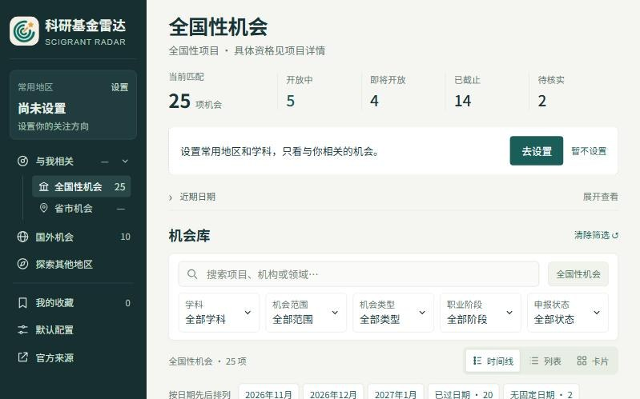

## 做的东西

- 

  **[flowfocus.space](https://flowfocus.space)**
  可视化年度规划工具：一页看全年，再落到每周和今天。免费，不用注册。

- 

  **[scigrantradar.com](https://scigrantradar.com)**
  科研基金雷达：把分散在各处的基金、人才、博士后和交流项目收到一条时间线上。

- 

  **[art4kid.com](https://art4kid.com) 待更新**
  带孩子逛世界名画，让 AI 用小朋友能理解的方式做中英文讲解。

## 找到我

- B站：[space.bilibili.com/13854592](https://space.bilibili.com/13854592)
- 公众号：扫下面的二维码





