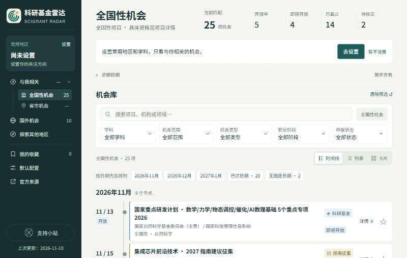
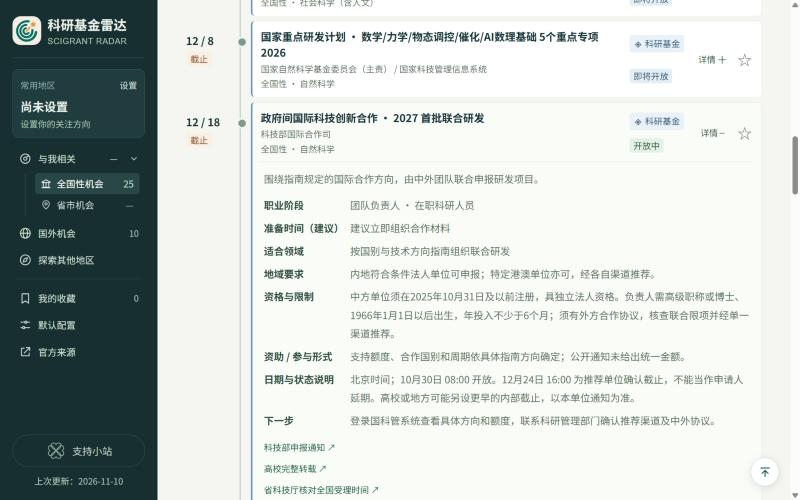
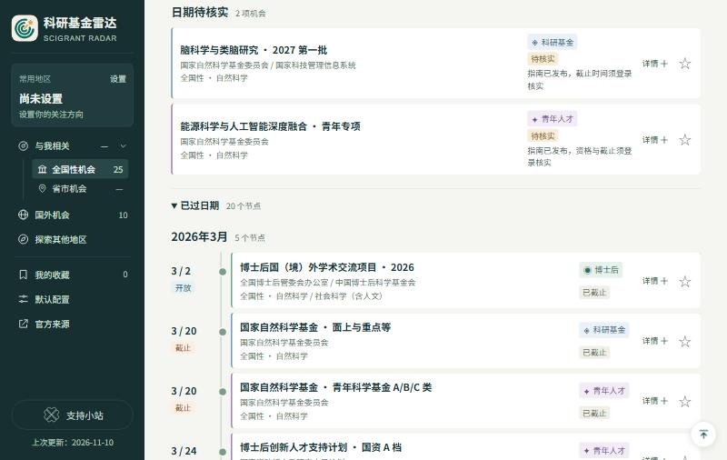
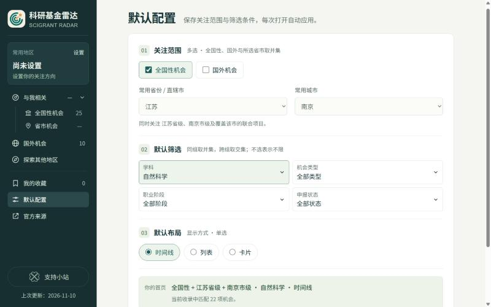

做科研的人大概都有过这样的经历：想知道最近有哪些基金可以申请，要去基金委看一遍，去科技部的系统看一遍，再去省科技厅、市科技局和学校科研院的通知栏各翻一遍。国外的项目又是另外一批网站。每个网站的栏目结构都不一样，有的通知藏在附件里，有的要登录才能看到截止时间。

这件事本身不难，只是很琐碎，而且每隔一段时间就要重复一次。更麻烦的是，等看到通知时，离截止往往只剩两三周，前期的准备已经来不及了。

所以我做了一个小站：**科研基金雷达**，网址是 [scigrantradar.com](https://scigrantradar.com)。它做两件事：

1. 把分散在各处的资助机会收集到一个地方；
2. 把最近的和往年的记录放在同一条时间线上，方便提前安排自己的时间。

网站免费、公开，不需要注册和登录。

## 1. 收录了什么

目前一共 68 条记录，分成四类机会：

- **科研基金**：国家自然科学基金、国家社科基金、重点研发计划、教育部项目，以及省市的科技计划和社科规划项目；
- **青年人才**：青年科学基金、学会的青年人才托举项目等；
- **博士后**：中国博士后科学基金、国家资助博士后计划、国家公派博士后等；
- **交流合作**：公派访问学者、国际合作专项、暑期项目等。

按范围来看：

| 范围 | 数量 | 说明 |
| --- | --- | --- |
| 全国性 | 25 | 基金委、科技部、全国社科工作办、教育部、留基委、博士后基金会等 |
| 省级 | 18 | 江苏、浙江、上海、安徽、北京、广东 |
| 市级 | 14 | 南京、苏州、杭州、宁波、合肥、深圳、广州、韶关 |
| 国外 | 10 | MSCA、洪堡、JSPS、EMBO、HFSP、DAAD、Royal Society Newton 等 |
| 跨区域联合 | 1 | 长三角 |

省市部分现在主要集中在长三角和少数几个省市，这是从我自己最常看的地区开始的，后面会慢慢补。

## 2. 一条时间线，同时看未来和过去

网站默认用时间线排列。每个项目的“开放”和“截止”是两个独立的节点，按日期先后排下来，一眼就能看到接下来几周有哪些要动手、哪些快到期。

点开任意一条的“详情”，可以看到职业阶段、适合领域、地域要求、资格与限制、资助形式、建议的准备时间和下一步该做什么，最下面是官方通知的链接。

已经截止的项目不会被删掉，而是留在时间线下方的“已过日期”里。

这是我觉得最有用的部分。很多项目每年的节奏相近：知道今年的面上项目是 3 月 20 日截止、博士后面上资助是 8 月底截止，就可以大致估计明年什么时候该开始准备，把写本子的时间和论文、项目、教学错开，而不是等通知出来才开始赶。

需要说明的是，往年的日期只用来做参考。新一年的日期在官方通知发布之前，网站上不会直接沿用上一年的，而是写明“尚未核实”。

## 3. 只看与自己相关的

第一次打开时，看到的是全部全国性机会。在“默认配置”里可以选常用的省份和城市、学科（自然科学或社会科学）、机会类型、职业阶段和申报状态，保存之后每次打开都会自动应用。

比如选了江苏和南京，首页就会同时显示全国性项目、江苏省级项目、南京市级项目，以及覆盖南京的联合项目。

另外还有几个小功能：

- 可以收藏感兴趣的项目；
- 时间线、列表、卡片三种显示方式可以切换；
- 每条记录的详情里有“复制分享链接”，发给同事或学生，对方打开就会直接定位到这一条。

## 4. 信息从哪里来，可信吗

收集信息的网站，最怕的是日期写错。所以网站的数据遵守几条规矩：

- **每条记录都附官方来源链接和核验日期。** 核验日期只有在这条记录确实被重新核对过时才会更新。
- **读不到原文，就标“待核实”。** 有些通知需要登录申报系统才能看到截止时间，这种情况不会去猜，而是如实写明。
- **不沿用往年日期，也不按惯例推测截止时间。**
- **每周更新，人工审阅后才上线。** 每周由一个自动程序查阅官方来源，整理出新增和更正的内容；我逐条看过之后才会发布。未经审阅的数据不会出现在网站上。

上线当天试运行时就遇到了一个例子。“政府间国际科技创新合作”2027 年第一批项目，原先记录的截止日期是 11 月 30 日，依据的是一所高校的转载。这次读到科技部的原文，写的是 12 月 18 日 16:00。两个日期相互矛盾，自动程序没有擅自改动，而是把问题留给我判断。我打开科技部的原始通知核对之后，才把日期更正为 12 月 18 日。

这也是一个值得留意的地方：高校转载通知时写的日期，可能是校内截止时间，会比资助方的截止时间更早。所以网站上的日期都以资助方原文为准。

需要特别提醒的是：**科研基金雷达只是一个便捷的入口，不能代替官方通知。** 它帮你更快地发现机会、找到原文，但真正准备申报时，请一定做两件事：

- 点开记录里的官方链接，自己阅读最新的通知和指南原文，资格、材料和日期都以原文为准；
- 和本校（本单位）负责的科研管理工作人员核对，确认是否限项、需要哪些校内流程，以及校内的截止日期。

## 5. 还不完善的地方

网站刚上线，有不少局限，先说清楚：

- 省市覆盖有限，目前只有上面列出的几个省市；
- 部分官方网站不稳定或无法直接访问，试运行中就有几个来源没有读到，相关记录保持原样并登记了问题；
- 每周的自动收集目前只完整试运行过一次，按计划的每周运行从 11 月 15 日开始，是否每次都足够全面，还需要一段时间来验证；
- 界面目前只有中文，收录的也主要是中国的项目和一部分国外项目。以后希望扩展到其他国家的资助，方便其他国家的人查看，不过怎么整合我还没想好。

如果你发现哪条信息有误，或者希望补充某个地区、某类项目，欢迎到 [GitHub 上提交 issue](https://github.com/kxqdesign/scigrantradar/issues)，最好附上官方通知的链接。

## 6. 最后

做这个网站的出发点很简单：去各处收集这些信息很麻烦，我想省下这部分时间；同时，把最近和往年的记录放在一起，就能更合理地安排自己一年里的节奏。

如果你也在准备申请基金、博士后或交流项目，欢迎试试看：[scigrantradar.com](https://scigrantradar.com)。

希望它能帮你少翻几个网站，多留一点时间给申请书本身。也再提醒一次：看到合适的项目后，请以官方通知为准，并和本校负责的老师核对。
